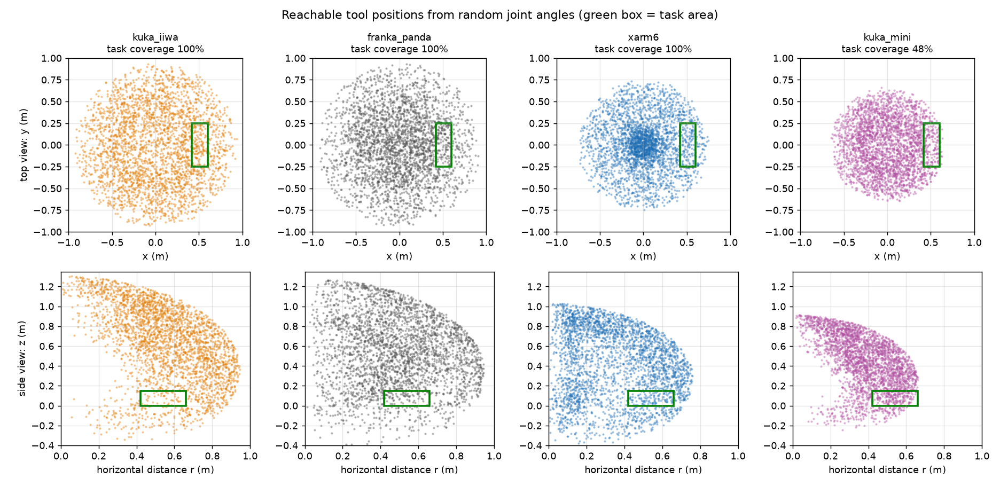
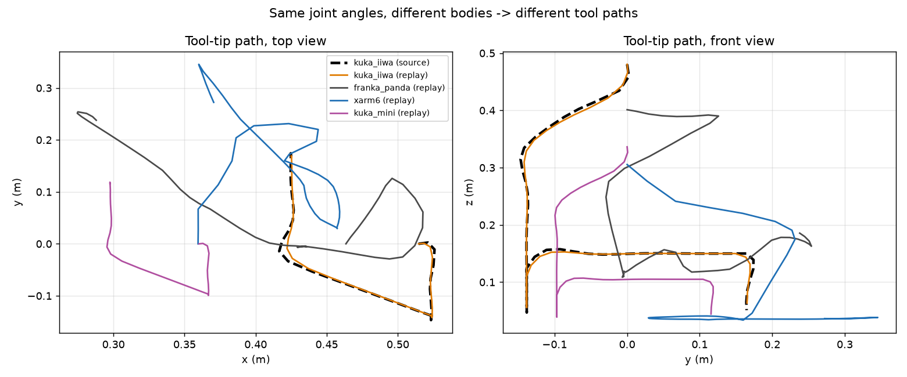
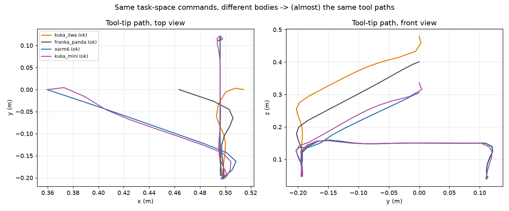
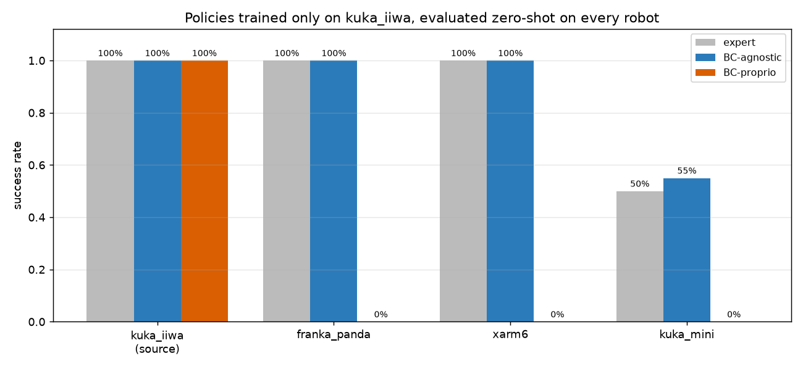
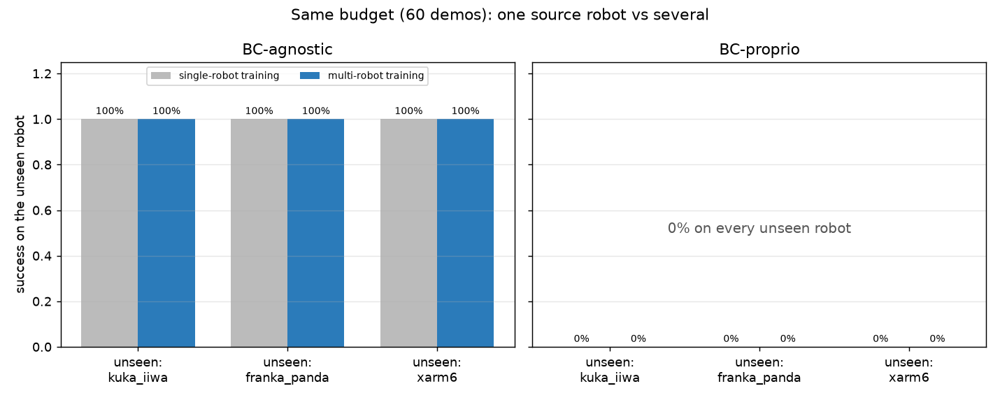

# Lab Manual: Cross-Embodiment Transfer of a Manipulation Skill

**Course:** CSAI4014 Algorithms for Intelligent Systems and Robotics (AISR)\
**Programme:** B.Tech CSE (AI & ML), Semester VII, UPES Dehradun\
**Tool:** PyBullet (Python) | **Duration:** 2 hours in the lab + short write-up\
**Prepared by:** Dr. Resham Raj Shivwanshi, School of Computer Science

---

## 1. Aim

To study whether a pick-and-place skill developed on one robot arm can be transferred to
robot arms with different kinematics, numbers of joints and sizes, and to identify which
design choices make the transfer succeed or fail.

## 2. Objectives

After this experiment you should be able to:

1. describe a robot's *embodiment* using measurable quantities (DOF, joint limits, reach, workspace);
2. explain why copying joint angles from one robot to another does not transfer a skill;
3. use a shared task-space action space and an inverse-kinematics (IK) adapter to transfer a skill;
4. train a behaviour-cloning policy and test it zero-shot on unseen robots;
5. explain how the choice of observation (task-space only vs. joint angles) affects transfer;
6. separate an *interface* problem (fixable by software) from a *capability* problem (the body cannot do it).

---

## 3. Theory

### 3.1 Embodiment

The **embodiment** of a robot is everything about its body that affects how a command turns
into motion: the number of joints (degrees of freedom, DOF), link lengths, joint limits,
motor strength and speed, the gripper, and where the robot is mounted. A skill such as
"pick the cube and put it on the goal" is the same task for every robot, but the joint
motions that achieve it are completely different on each body.

**Cross-embodiment transfer** means reusing a skill, a dataset or a learned policy from a
*source* robot on a *target* robot without collecting a full new training set on the target.

### 3.2 The embodiment gap

There are four kinds of mismatch between two robots:

| Gap | Example in this lab | Can software fix it? |
|---|---|---|
| **Action-space gap** | KUKA has 7 joints, xArm6 has 6; joint 4 of the Panda only bends one way | Yes: command the tool in Cartesian (task) space and let each robot's IK compute its own joints |
| **Observation gap** | A policy that reads joint angles sees numbers that mean different things on each robot | Yes: feed the policy body-independent quantities (tool, object and goal positions) |
| **Dynamics gap** | Different motor torques, speeds and link masses | Partly: low-level controllers, feedback, slower commands |
| **Capability gap** | The 70%-scale KUKA cannot reach the far half of the task area | No: the body cannot do the task there; you need a different setup or a different robot |

### 3.3 Joint space vs. task space

For an arm with joint vector **q** (length n), forward kinematics gives the tool pose,
**x** = FK(**q**). Inverse kinematics solves the reverse problem, **q** = IK(**x**).
FK and IK are different functions for every robot, so

* the same **q** on two robots gives two different tool poses (Experiment 2), but
* the same desired **x** can be sent to any robot that has its own IK (Experiment 3).

PyBullet's `calculateInverseKinematics` uses a damped-least-squares solver with null-space
"rest poses", which is how a 7-DOF arm chooses one of infinitely many solutions.

### 3.4 The shared interface used in this lab

```
            shared observation o (10 numbers)              shared action a (4 numbers)
  world ──► [tool xyz, holding, cube xyz, goal xyz] ──► POLICY ──► [dx, dy, dz, grip]
                                                                          │
                       ┌──────────────────────────────────────────────────┘
                       ▼
          EMBODIMENT ADAPTER (one per robot)
          target = tool + a·0.02 m  →  own IK  →  clip to own joint limits  →  own motors
                       │
                       ▼
          KUKA iiwa (7)   |   Franka Panda (7)   |   xArm6 (6)   |   KUKA 70% (7)
```

All positions are measured in each robot's own base frame, so a policy never knows which
robot it is driving. The gripper is a "suction cup" abstraction: when `grip > 0` and the tool
tip is within 3 cm of the cube's top face, the cube is attached; when `grip <= 0` it is released.
Real cross-embodiment datasets (Open X-Embodiment, 2024) use the same idea: actions are stored
as end-effector displacements plus a gripper command.

### 3.5 Behaviour cloning and noise injection

**Behaviour cloning (BC)** is supervised learning on (observation, expert action) pairs: a neural
network (here a 2-layer, 256-unit MLP) is trained to output the expert's action. A known problem
is **covariate shift**: small errors take the robot to states the expert never visited, and errors
grow. We reduce this by adding Gaussian noise to the executed action while recording the clean
expert action as the label (the DART method). The policy then sees how the expert *recovers*.

### 3.6 Multi-embodiment training

Large robot models (RT-X, Octo, CrossFormer, HPT) are trained on data from many robots at once.
The hope is that diversity of bodies makes the policy rely on what is common (the task) rather
than what is specific (the body). Experiment 5 tests this idea at small scale.

---

## 4. Apparatus / software

* A computer with Python 3.10 or 3.11 and the packages in `requirements.txt` (PyBullet, NumPy,
  Matplotlib, scikit-learn, Pillow). Installation: see `README.md`, sections 2 to 4.
* The project folder `AISR-Cross-Embodiment-PyBullet`.
* No GPU and no internet connection are needed once installed.

### 4.1 The four robots

| Key | Robot | Arm DOF | Notes |
|---|---|---|---|
| `kuka_iiwa` | KUKA LBR iiwa | 7 | source robot by default |
| `franka_panda` | Franka Emika Panda | 7 | different link offsets, joint 4 bends one way only, has fingers (held open) |
| `xarm6` | UFactory xArm6 | 6 | one joint fewer, shorter reach |
| `kuka_mini` | KUKA iiwa scaled to 70% | 7 | identical shape and joints, but a much smaller body |

### 4.2 The task

* A 5 cm red cube appears at a random place on the right (x 0.42 to 0.60 m, y -0.25 to -0.08 m).
* A green goal disc appears at a random place on the left (x 0.42 to 0.60 m, y 0.08 to 0.25 m).
* **Success:** the cube rests (released, on the floor) with its centre within 4 cm of the goal centre.
* An episode lasts at most 300 control steps (10 s at 30 Hz).
* For a given random *seed*, every robot gets exactly the same cube and goal positions.

---

## 5. Pre-lab questions (answer before the lab)

1. Define degrees of freedom of a serial manipulator. Why does a 7-DOF arm have infinitely many
   IK solutions for one tool pose?
2. What is the difference between joint space and task (Cartesian) space?
3. In one line each, what are forward kinematics and inverse kinematics?
4. What is behaviour cloning? Name one weakness.
5. Guess: if you send the KUKA's joint angles to the Panda, will the Panda pick the cube? Why?

---

## 6. Procedure

Open a terminal in the project folder and activate your environment
(`conda activate aisr-xembody`, or `source .venv/bin/activate`, or `.\.venv\Scripts\Activate.ps1`).
Every command prints a table and saves files in `results/`. Copy the numbers into the
observation tables of Section 7.

### Part 0: Check the setup (5 min)

```bash
python experiments/00_check_setup.py --gui
```
A window shows the four robots side by side. The terminal must end with `SETUP OK`.
(Without a display, drop `--gui`; open `results/00_setup_snapshot.png` instead.)

### Part 1: Measure the bodies (10 min)

```bash
python experiments/01_explore_embodiments.py
```
The script

* reads each robot's joints and limits from its URDF file,
* samples 3000 random joint configurations and plots where the tool tip ends up
  (`results/01_workspace.png`),
* checks, for 90 points in the task area (grasp height and travel height), whether the robot can
  put its tool there pointing straight down (**task coverage**).

**Record** DOF, maximum reach and task coverage in Table 1. Look at `01_workspace.png`: which
robot's workspace covers the green task rectangle, and which does not?

### Part 2: Naive transfer in joint space (15 min)

```bash
python experiments/02_joint_space_transfer.py --gui
```
The expert does the task on the KUKA while the joint angles are recorded. The same joint angles
are then replayed on every robot (missing joints dropped, extra joints at home, angles clipped to
each robot's limits). With `--gui` you watch the first replay on each robot; close nothing, each
window closes on its own. Then run it headless for the numbers:
```bash
python experiments/02_joint_space_transfer.py --episodes 10
```
**Record** success rate, mean path deviation and cube error in Table 2. Open
`results/02_joint_space_paths.png`. The black dashed line is the KUKA's tool path.

### Part 3: Transfer through task space (15 min)

```bash
python experiments/03_task_space_transfer.py --episodes 20
```
Now the expert sends **tool displacements** and each robot's own IK computes its joints.
To watch one robot: `python experiments/03_task_space_transfer.py --gui --robots xarm6 --episodes 2`.

**Record** results in Table 3 and compare `03_task_space_paths.png` with `02_joint_space_paths.png`.

### Part 4: Learn on one robot, deploy on all (25 min)

```bash
python experiments/04_learn_once_deploy_many.py
```
1. 60 demonstrations are collected on the KUKA only (noisy execution, clean labels).
2. Two BC policies are trained on exactly the same data:
   **BC-agnostic** (task-space features only) and **BC-proprio** (task-space features + the 7
   joint angles).
3. Both policies and the expert are evaluated on 20 new layouts on every robot.

**Record** Table 4 and look at `results/04_learn_once_deploy_many_kuka_iiwa.png`.
Then watch the learned policy drive all four robots together:
```bash
python experiments/06_side_by_side_demo.py --gui --policy results/models/bc_agnostic_kuka_iiwa.pkl
```
and the joint-aware one:
```bash
python experiments/06_side_by_side_demo.py --gui --policy results/models/bc_proprio_kuka_iiwa.pkl
```

### Part 5: Train on several robots, test on an unseen one (20 min)

```bash
python experiments/05_multi_embodiment.py
```
For each robot in {KUKA, Panda, xArm6}, the robot is held out. Two training sets with the **same
total of 60 demonstrations** are built from the other robots: *single* (all 60 from one robot)
and *multi* (30 + 30 from two robots). Both observation designs are tested on the held-out robot.

**Record** Table 5 and look at `results/05_multi_embodiment.png`.

### Part 6 (bonus): You are the policy

```bash
python experiments/07_teleop.py --robot franka_panda xarm6
```
Click the window, then use the arrow keys, `z`/`x` (up/down), `space` (suction) and `n` (new
layout). The same key presses move two different robots identically: you are using the shared
task-space interface yourself.

### Shortcut

`python run_all.py --quick` runs Parts 0 to 5 with smaller numbers (3 to 5 minutes) and saves
every figure. Use it if your machine is slow, then fill the tables from the printed output.

---

## 7. Observation tables

**Table 1. Embodiments** (from Part 1)

| Robot | Arm DOF | Max reach (m) | Task coverage (%) |
|---|---|---|---|
| kuka_iiwa | | | |
| franka_panda | | | |
| xarm6 | | | |
| kuka_mini | | | |

**Table 2. Joint-space replay of KUKA trajectories** (Part 2)

| Robot | Success rate | Mean path deviation (cm) | Median cube-goal error (cm) |
|---|---|---|---|
| kuka_iiwa (itself) | | | |
| franka_panda | | | |
| xarm6 | | | |
| kuka_mini | | | |

**Table 3. Task-space transfer of the expert** (Part 3)

| Robot | Success rate | Mean steps (successful episodes) | Median cube-goal error (cm) |
|---|---|---|---|
| kuka_iiwa | | | |
| franka_panda | | | |
| xarm6 | | | |
| kuka_mini | | | |

**Table 4. Learn on KUKA, deploy everywhere** (Part 4, success rates)

| Robot | Expert | BC-agnostic | BC-proprio |
|---|---|---|---|
| kuka_iiwa (source) | | | |
| franka_panda | | | |
| xarm6 | | | |
| kuka_mini | | | |

**Table 5. Leave-one-embodiment-out** (Part 5, success on the unseen robot)

| Unseen robot | single, agnostic | multi, agnostic | single, proprio | multi, proprio |
|---|---|---|---|---|
| kuka_iiwa | | | | |
| franka_panda | | | | |
| xarm6 | | | | |

---

## 8. Analysis questions (write in your record)

1. In Part 2 the KUKA replaying its *own* joint angles succeeds. Why does the same replay fail on
   `kuka_mini`, which has exactly the same joints and the same joint angles?
2. Panda and KUKA both have 7 joints. Why is having the same number of joints not enough?
3. In Part 3, which robot still fails, and is the cause the interface, the policy or the body?
   Use Table 1 to justify your answer.
4. In Part 4, BC-agnostic and BC-proprio were trained on identical data and both do well on the
   source robot. Explain the difference on the other robots in terms of the *observation gap*.
5. On `kuka_mini`, BC-agnostic and the expert score almost the same. Why is the body, not the policy,
   the limit here? Why can the two still differ by an episode or two?
6. In Part 5, does multi-embodiment training help BC-proprio? Does it matter for BC-agnostic? Why?
7. The suction gripper hides the difference between grippers. Name two things that would make a
   real two-finger gripper harder to transfer.
8. Suggest one way to make `kuka_mini` succeed without changing the policy.

---

## 9. Exercises (choose any two)

| # | Change | Command / file |
|---|---|---|
| E1 | Use a different source robot | `python experiments/04_learn_once_deploy_many.py --source xarm6` |
| E2 | Fewer demonstrations: does transfer break before source performance breaks? | `--demos 10`, `--demos 20`, `--demos 40` |
| E3 | Remove noise injection | in `xembody/policy.py`, `collect_demos(..., noise=0.0)` |
| E4 | Change the robot scale (e.g. 0.75, 0.9) and find the smallest KUKA that still succeeds | `scale` in `xembody/robots.py` (`kuka_mini`) |
| E5 | Move a robot's base closer to the task (e.g. `base_pos=(0.15, 0, 0)`) and repeat Part 3 for `kuka_mini` | `Station` in `xembody/world.py` |
| E6 | Add a new embodiment (any arm URDF), give it a key in `EMBODIMENTS`, and run Parts 1, 3 and 4 on it | `xembody/robots.py` |

---

## 10. Result

Write 4 to 6 lines covering: (a) the success rate of joint-space transfer vs. task-space transfer,
(b) the zero-shot success of BC-agnostic and BC-proprio on robots never seen in training,
(c) which failures were caused by the interface or observation design and which by the body itself.

## 11. Conclusion (sample structure)

"A skill expressed in joint space does not transfer, even between arms with the same number of
joints. Expressing actions and observations in a shared task space, with a per-robot IK adapter,
allowed a policy trained on one robot to run unchanged on robots it had never seen. Adding joint
angles to the observation made the policy depend on the source body. No interface can transfer a
skill to a body that cannot reach the task."

---

## 12. Viva questions

1. What is an embodiment gap? Give the four types with one example each.
2. Why is task-space control a natural "common language" between different arms?
3. What does the IK rest pose (null-space target) do for a 7-DOF arm?
4. What is covariate shift in behaviour cloning, and how does noise injection (DART) help?
5. Why do large cross-embodiment datasets store end-effector deltas instead of joint angles?
6. When would you *want* joint angles in the observation?
7. How would you detect a capability gap automatically before deploying a policy on a new robot?
8. What is the role of the gripper abstraction in this experiment?

---

## 13. References

1. Open X-Embodiment Collaboration, "Open X-Embodiment: Robotic Learning Datasets and RT-X Models,"
   IEEE ICRA, 2024.
2. Octo Model Team, "Octo: An Open-Source Generalist Robot Policy," Robotics: Science and Systems (RSS), 2024.
3. R. Doshi, H. Walke, O. Mees, S. Dasari, S. Levine, "Scaling Cross-Embodied Learning: One Policy for
   Manipulation, Navigation, Locomotion and Flight," CoRL, 2024.
4. L. Wang, X. Chen, J. Zhao, K. He, "Scaling Proprioceptive-Visual Learning with Heterogeneous
   Pre-trained Transformers," NeurIPS, 2024.
5. M. Laskey, J. Lee, R. Fox, A. Dragan, K. Goldberg, "DART: Noise Injection for Robust Imitation
   Learning," CoRL, 2017.
6. S. Ross, G. Gordon, D. Bagnell, "A Reduction of Imitation Learning and Structured Prediction to
   No-Regret Online Learning," AISTATS, 2011.
7. E. Coumans, Y. Bai, "PyBullet, a Python module for physics simulation for games, robotics and
   machine learning," http://pybullet.org, 2016 to 2024.
8. S. Russell, P. Norvig, *Artificial Intelligence: A Modern Approach*, 3rd ed., Chapter 25 (Robotics).

---

## Appendix A. Reference results (instructor's run)

Measured by the instructor on macOS 26 (Apple M4), Python 3.11, PyBullet 3.2.7, scikit-learn 1.9,
with the default settings (`python run_all.py`). All random seeds are fixed, so on the same
library versions you should get the same numbers. On other machines small differences are normal;
the trends must be the same. Use these to check your run, not to fill your tables.

**A.1 Embodiments (Part 1)**

| Robot | Arm DOF | Max reach (m) | Task coverage |
|---|---|---|---|
| kuka_iiwa | 7 | 0.95 | 100% |
| franka_panda | 7 | 0.94 | 100% |
| xarm6 | 6 | 0.76 | 100% |
| kuka_mini | 7 | 0.66 | 48% |



Note that `kuka_mini`'s random-joint cloud *does* touch the task box, yet only 48% of task points
are reachable with the tool pointing straight down. Reaching a point is not the same as reaching it
in the orientation the task needs. (Points below z = 0 appear because random joint angles ignore the floor.)

**A.2 Joint-space replay of KUKA trajectories (Part 2, 10 episodes)**

| Robot | Success | Mean path deviation (cm) | Median cube-goal error (cm) |
|---|---|---|---|
| kuka_iiwa (itself) | 100% | 1.4 | 0.05 |
| franka_panda | 0% | 16.7 | 29.2 |
| xarm6 | 0% | 27.2 | 34.3 |
| kuka_mini | 0% | 17.6 | 34.3 |



`kuka_mini` traces a shrunken copy of the KUKA path: identical angles, shorter links.

**A.3 Task-space transfer of the expert (Part 3, 20 episodes)**

| Robot | Success | Mean steps | Median cube-goal error (cm) |
|---|---|---|---|
| kuka_iiwa | 100% | 50.5 | 0.15 |
| franka_panda | 100% | 46.6 | 0.13 |
| xarm6 | 100% | 44.9 | 0.27 |
| kuka_mini | 30% | 43.8 | 1.54 |



**A.4 Learn on KUKA, deploy everywhere (Part 4, 60 demonstrations, 20 test episodes)**

| Robot | Expert | BC-agnostic | BC-proprio |
|---|---|---|---|
| kuka_iiwa (source) | 100% | 100% | 100% |
| franka_panda | 100% | 100% | 0% |
| xarm6 | 100% | 100% | 0% |
| kuka_mini | 50% | 55% | 0% |



Both BC policies are perfect on the robot they were trained on. Only the one whose input is
body-independent survives a change of body. On `kuka_mini` BC-agnostic matches the expert (55% vs
50%, one episode apart): both are limited by reach, and on layouts at the edge of the reachable area
a slightly different path decides success. (`kuka_mini` shows 50% here and 30% in A.3 because the
20 test layouts differ.) The Panda's cube error is larger than the KUKA's (0.9 cm vs 0.2 cm): the
Panda moves differently between control steps (a dynamics gap), which produces states slightly
outside the KUKA training data. With other random seeds this sometimes costs one or two episodes.

**A.5 Leave-one-embodiment-out (Part 5, 60 demonstrations per policy)**

| Unseen robot | single, agnostic | multi, agnostic | single, proprio | multi, proprio |
|---|---|---|---|---|
| kuka_iiwa | 100% | 100% | 0% | 0% |
| franka_panda | 100% | 100% | 0% | 5% |
| xarm6 | 100% | 100% | 0% | 0% |



BC-agnostic needs no help: it already transfers from a single robot, and two training bodies
mainly reduce the final placement error. Training on two bodies does **not** rescue BC-proprio
(0 to 5%): two bodies are far too few for the network to learn that joint angles should be ignored.
Large cross-embodiment models use data from dozens of robots and body-specific input layers for
exactly this reason.

**A.6 Suggested timing for a 2-hour lab**

| Time | Activity |
|---|---|
| 0:00 to 0:15 | Theory recap (Sections 3.1 to 3.4), demo `06_side_by_side_demo.py --gui` on the projector |
| 0:15 to 0:25 | Part 0 and Part 1 |
| 0:25 to 0:55 | Parts 2 and 3 (start Part 4 running in the background at 0:45) |
| 0:55 to 1:25 | Part 4 and discussion of Table 4 |
| 1:25 to 1:45 | Part 5 (or `run_all.py --quick` on slow machines) |
| 1:45 to 2:00 | Bonus teleop, analysis questions, viva |
